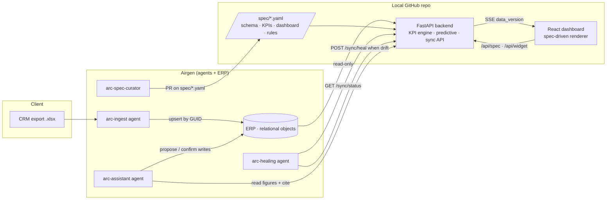

# Architecture

## Responsibilities
| Layer | Owns | Never does |
|---|---|---|
| Airgen agents | moving, validating, healing, explaining, proposing | compute KPIs, render screens |
| Airgen ERP | the data, relationships, audit, snapshots | business definitions |
| Backend | KPI definitions (one definition + one governing date each), filters, scope stamps, predictive indicators, drift detection | write business data (except snapshots/audit) |
| Frontend | render whatever `/api/spec` says; filters in URL; live refresh | hard-code pages or fields |

## Healing loop
1. Someone/something changes the ERP (ingest, user edit, assistant-applied change).
2. `GET /api/sync/status` shows `drift: [objects]` (per-object count+checksum differs from what the screen serves).
3. `arc-healing` (or the backend watcher) calls `POST /api/sync/heal` → data reload, model retrain, spec regeneration, `version++`.
4. `GET /api/events` (SSE) pushes `data_version`; the browser refetches only visible widgets and shows "Updated from ERP".
5. Heal is idempotent; every heal is audited in `agent_action`.

## Dynamic dashboard
`spec/dashboard.yaml` (curated, hot-reloaded) + `specgen.py` (profiles the live ERP data: dynamic columns → filters/bars/KPIs; unreferenced objects → auto pages) → `/api/spec` → React renders widgets by `type`. A widget is `kpi id + overrides`; the engine resolves it against `spec/kpis.yaml`.

## Predictive (Phase-3 preview, BRD-compliant)
Win probability (logistic regression, WON vs LOST, leakage-checked features) → expected GP per open deal → expected GP by close month with p10–p90 simulation band, shown beside the CRM's own weighted figure. Drivers and AUC are always displayed; unavailable when <20 won or lost deals.

## Security
Backend uses a read-only ERP key; writes (`/sync/heal`, `/ingest`, `/audit`, `/snapshots`) need `X-API-Key`. Per-agent keys and sandbox env vars in Airgen. Row-level scoping (NFR-08) is **not** implemented yet — it must be enforced in the ERP data layer.
